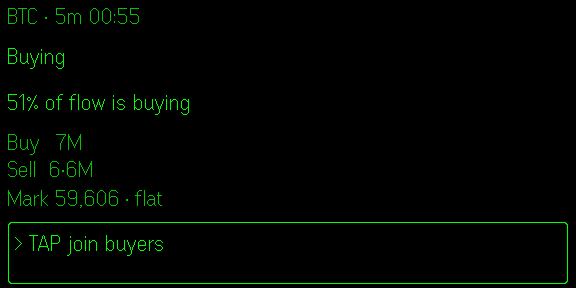
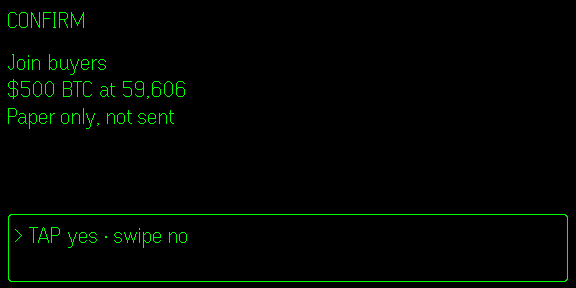
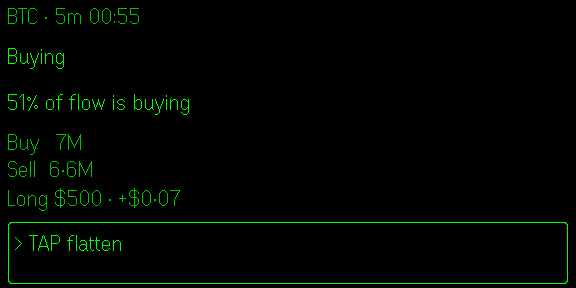
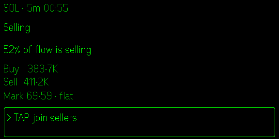

# Taker Side

Taker Side is an Even G2 app for a trading session. It shows one thing: who is crossing the spread on OKX right now, buyers or sellers, and lets you mark a $500 paper position on that side with one tap.

It is built for the DoraHacks **Heads Up: Even Realities Hackathon**, track **Exchanges & Stocks**. The core integration is OKX's public market data. There is no API key, no account, and no order is ever sent.

## What you see

On the glasses, for BTC, ETH, or SOL:

- the current 5-minute taker bar from OKX (buy volume, sell volume, and which side has more)
- the live OKX mark, which is the price a paper fill uses
- one action: join that side, or flatten the paper clip you already have

Swipe to the next coin. A confirm screen appears before any paper fill. If takers flip to the other side while you hold a clip, the verdict line says **Flipped**.

Paper only. Starting cash is $10,000. Each clip is $500 of notional. Nothing is routed to OKX.









## Track

**Exchanges & Stocks.** Apps in that track include Binance, OKX, Bybit, Coinbase, and Interactive Brokers. This app uses OKX only: public taker volume and public mark price for the BTC, ETH, and SOL USDT swaps.

## What already existed on 23 Nov 2026

The project started from the official Even Realities template [`evenhub-templates/minimal`](https://github.com/even-realities/evenhub-templates) (Vite, TypeScript, `index.html` shell, `app.json`, and the SDK startup that waits for the bridge and leaves on a double tap). The OKX feed, paper book, glasses copy, and companion screen were written for this hackathon.

## Test it yourself (Windows)

This is the path if you do not write code.

1. Install the **LTS** version of Node.js from [https://nodejs.org](https://nodejs.org). Use the Windows installer and leave "Add to PATH" checked. Close and reopen any command window afterwards.
2. On the GitHub page for this project, click the green **Code** button, then **Download ZIP**. Unzip it. You get a folder named `taker-side-main`.
3. Open that folder. Click the address bar at the top of the folder window, type `cmd`, and press Enter. A command window opens in the right place.
4. Paste this, then press Enter. Wait until it finishes.

```bat
npm install
```

5. Paste this and leave the window open.

```bat
npm run dev
```

6. Open [http://127.0.0.1:4177](http://127.0.0.1:4177) in Chrome or Edge. The black green screen is the glasses preview. **Click** joins or confirms. **Up** and **Down** change the coin, or cancel a confirm.

A second command window, opened the same way in the same folder, runs the official Even Hub simulator:

```bat
npm run simulate
```

Use the buttons in that window. The header on the glasses should show a coin and `5m`. If it says `DEMO`, OKX did not answer. Close both windows and start `npm run dev` again before you record.

## Try it without installing

A public preview page is prepared. It is not on the internet yet, because this project is not in a public GitHub repository yet. After the repository `taker-side` exists under `soakinvet`:

1. Open the repository on GitHub.
2. Click **Settings**, then **Pages**.
3. Under **Build and deployment**, set **Source** to **GitHub Actions**.

The address will be [https://soakinvet.github.io/taker-side/](https://soakinvet.github.io/taker-side/). That page draws the same 576 by 288 glasses screen in the browser, with Click, Up, and Down. OKX's taker feed usually cannot be read from a public page, so the header says `DEMO`. Live OKX numbers need `npm run dev`.

## Run it

You need Node.js 18 or newer. On Linux the simulator also needs WebKitGTK:

```bash
sudo apt-get install -y libwebkit2gtk-4.1-0
```

Then, in this folder:

```bash
npm install
```

Terminal 1:

```bash
npm run dev
```

Leave that running. It serves the app at [http://127.0.0.1:4177](http://127.0.0.1:4177) and proxies OKX.

Terminal 2:

```bash
npm run simulate
```

The simulator window is the glasses. Use its buttons:

| Button | What it does |
| --- | --- |
| Click | Open the confirm, or accept it |
| Up | Next coin (BTC, ETH, SOL). On a confirm screen, cancels |
| Down | Previous coin. On a confirm screen, cancels |
| Double click | Leave the app |

Give the first OKX read a couple of seconds. The header shows the coin and the bar time, for example `BTC · 5m 00:55`. If it says `DEMO`, the live feed did not answer and the screen is a labeled practice tape. Quit and run `npm run dev` again before recording the demo.

To force the practice tape: open the simulator against `http://127.0.0.1:4177/?feed=mock`.

## Why the dev server is in the middle

OKX's taker-volume endpoint does not send `Access-Control-Allow-Origin`, so a page cannot read it directly. Mark price does. The Vite dev server proxies both under `/okx`, which is the setup the Even Hub docs recommend when an API has no CORS headers. The simulator loads that dev server, so the demo is live OKX data.

The optional `.ehpk` calls `https://www.okx.com` directly. On a phone, taker volume may be blocked by CORS and the glasses will say `DEMO` instead of pretending the numbers are live. Record the video from `npm run dev` plus the simulator.

## Package

```bash
npm run pack
```

That typechecks, builds, and writes `release/taker-side.ehpk`. The hackathon lists this file as optional.

## Tests

```bash
npm test
```

These cover the OKX row order (timestamp, sell, buy), the paper fill math, and the tap / swipe decisions. They do not need the simulator.

## Architecture

```
OKX public REST
  taker volume, 5-minute contracts bar
  swap mark price
        |
        v
Vite proxy /okx          only while developing
        |
        v
src/feed.ts              fetch and parse
src/model.ts             side, percent, paper book, glasses copy
src/main.ts              Even Hub bridge, 576×288 text containers, gestures
src/companion.ts         the phone page inside the simulator
```

Gestures follow the template: a tap is a click, a swipe is a scroll event, a double tap calls `shutDownPageContainer(1)`. A tap waits a fraction of a second so a double tap cannot also fill a paper clip.

The glasses font has no period glyph, so decimals use a middle dot (`6·6M`, `69·59`).

## Safety

- Read-only OKX market data. No API key in the repo.
- Paper clips stay on the device. The confirm line says they are not sent.
- This is not financial advice and not a signal to trade.
